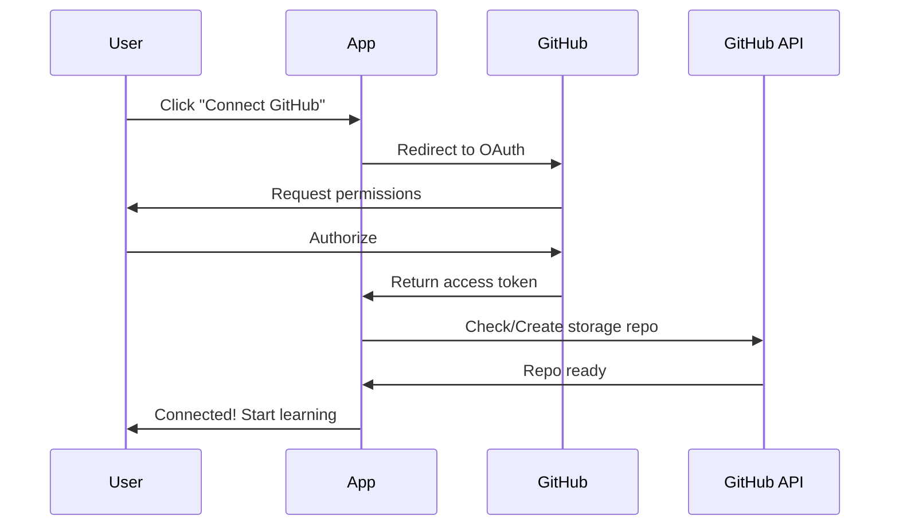

# GitHub Backend Integration Guide

## Overview
Rust.Hub uses GitHub as a decentralized backend for storing user progress, enabling discussions, and managing community contributions.

## Features Configured

### 1. GitHub Pages 🌐
- **URL**: https://southwest-ai-labs.github.io/rust-patterns-visuals
- **Deployment**: Automatic on push to `master` branch
- **Workflow**: `.github/workflows/deploy_pages.yml`

### 2. GitHub Discussions 💬
- **Enabled**: ✅ 
- **Use Cases**:
  - Lesson-specific Q&A
  - Community help
  - Feature discussions
  - Show & Tell (sharing solutions)
  
Access: `https://github.com/southwest-ai-labs/rust-patterns-visuals/discussions`

### 3. GitHub Sponsors 💖
- **Enabled**: ✅
- **Configuration**: `.github/FUNDING.yml`
- Supports the development of new learning modules and features

### 4. Issues & Templates 🐛
Pre-configured templates for:
- Bug reports
- Feature requests
- Automatic routing to discussions for questions

## User Data Storage Architecture

### Personal Progress Storage
Each user's learning progress is stored in their **own private repository**:

```
User Repository: {username}/rust-patterns-storage
├── progress_v2.json (encrypted user progress)
└── forks/ (personal solution archives)
```

### How It Works

1. **First Time Setup**
   - User authenticates with GitHub OAuth
   - App creates `rust-patterns-storage` private repo in user's account
   - Initial progress file is created

2. **Progress Sync**
   - Every completed lesson/challenge updates `progress_v2.json`
   - Commits are tagged with MMR (Mastery Rating)
   - Full version control of learning journey

3. **Neural Forking**
   - Fork solutions from other users
   - Store in personal archive
   - Version-controlled learning artifacts

### API Endpoints Used

```typescript
// Check if user repo exists
GET /repos/{username}/rust-patterns-storage

// Create storage repo
POST /user/repos

// Read progress
GET /repos/{username}/rust-patterns-storage/contents/progress_v2.json

// Save progress
PUT /repos/{username}/rust-patterns-storage/contents/progress_v2.json

// Discussions (for lesson comments)
GET /repos/southwest-ai-labs/rust-patterns-visuals/discussions

// Community sharing
POST /repos/{username}/rust-patterns-storage/contents/forks/{filename}
```

## Configuration Files

### `.github/workflows/deploy_pages.yml`
Automated deployment to GitHub Pages on every push to master.

### `.github/FUNDING.yml`
GitHub Sponsors configuration for supporting the project.

### `.github/ISSUE_TEMPLATE/`
- `bug_report.md` - Bug report template
- `feature_request.md` - Feature request template
- `config.yml` - Issue routing configuration

### `vite.config.ts`
```typescript
base: '/rust-patterns-visuals/', // GitHub Pages base path
build: {
  outDir: 'dist',
  assetsDir: 'assets',
}
```

## Environment Variables

Required for full functionality:

```env
# Google Gemini AI for challenges
GEMINI_API_KEY=your_key_here

# GitHub OAuth (for user authentication)
GITHUB_CLIENT_ID=your_client_id
GITHUB_CLIENT_SECRET=your_client_secret
```

## Deployment Steps

### Initial Setup
1. Enable GitHub Pages in repository settings
2. Set source to "GitHub Actions"
3. Enable Discussions in repository settings
4. Enable Sponsors (if applicable)

### Automated Deployment
Every push to `master` triggers:
1. Install dependencies (`npm ci`)
2. Build production bundle (`npm run build`)
3. Deploy to GitHub Pages

### Manual Deployment
```bash
npm run build
gh-pages -d dist
```

## User Authentication Flow



## Permissions Required

GitHub OAuth Scopes:
- `repo` - Full control of private repositories (for progress storage)
- `read:user` - Read user profile information
- `write:discussion` - Post to community discussions

## Benefits of GitHub Backend

1. **Zero Server Costs** - All data storage is in user's GitHub account
2. **Privacy by Default** - User owns their data
3. **Version Control** - Full history of learning progress
4. **Decentralized** - No single point of failure
5. **Community Built-in** - Discussions, Issues, Sponsors
6. **Open Source** - Transparent and auditable

## Community Integration

### Lesson Discussions
Each lesson can have its own discussion thread:
```
/discussions/categories/lessons
```

### Show & Tell
Users can share their solutions:
```
/discussions/categories/show-and-tell
```

### Help Wanted
Request help from community experts:
```
/discussions/categories/q-a
```

## Monitoring & Analytics

GitHub provides built-in analytics:
- Traffic sources
- Page views
- Repository clones
- Discussion engagement
- Issue velocity

## Security Considerations

1. **Private Progress Repos** - User data never leaves their control
2. **Token Scoping** - Minimal permissions requested
3. **Client-Side Execution** - No code sent to external servers
4. **Encrypted Storage** - Progress files use base64 encoding

## Future Enhancements

- [ ] GitHub Projects for learning path tracking
- [ ] GitHub Actions for automated code reviews
- [ ] GitHub Wiki for comprehensive documentation
- [ ] Release tags for curriculum versions
- [ ] GitHub Packages for distributing Rust WASM modules

---

**Configured by**: Southwest AI Labs  
**Last Updated**: December 2025  
**Status**: ✅ Production Ready
