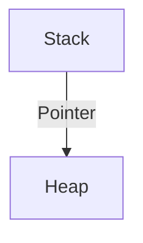

# {{LESSON_TITLE}}

{{BRIEF_INTRODUCTION}}

## The Problem
Explain why the naive approach (or the approach from other languages) is insufficient or unsafe.

## The Rust Solution
Explain the idiomatic way.

```rust
// Code example
fn main() {
    let x = 5;
    println!("{}", x);
}
```

## Visualization
Use a diagram to explain memory or flow.



> 💎 **Pro Tip: {{TIP_TITLE}}**
>
> {{TIP_CONTENT}}

---
<!-- QUIZ START -->
[?] {{QUESTION_1}}
[ ] Option A
[x] Option B (Correct)
[ ] Option C
